# Propuesta de mejoras de LegadoSeguro

**Autoras:** Katheryn Pardo Acosta, Fiorella Stefany Cabanillas Rojas · **Curso:** JavaScript Avanzado (UTP) · **Ciclo:** VI, 2026-02 · **Fecha:** 24/11/2026

## 1. Presentación

Este documento presenta las mejoras que el grupo propone para **LegadoSeguro** antes de la presentación final: qué se va a implementar, con qué tecnología, cómo se va a verificar y cómo se va a documentar. Cada mejora lleva una ficha de implementación con el mismo formato de 10 filas que usa el manual de construcción, de modo que lo que hoy se propone luego pueda incorporarse al manual como un procedimiento replicable.

### 1.1 Estado actual del sistema

LegadoSeguro es una plataforma web de gestión de legado y testamento digital. El propietario registra sus activos digitales, designa herederos y define una regla de liberación por inactividad; el administrador supervisa. Se construyó con Angular 22 (sin `zone.js`, con componentes independientes y *signals*) en el frontend, Node.js con Express y TypeScript en el backend, y Supabase (PostgreSQL) como base de datos (Angular, 2026; Express, 2026).

Tabla: Módulos ya terminados
| Módulo | Qué hace |
|---|---|
| Registro y sesión | DNI validado en RENIEC, código de 6 dígitos por correo, JWT, recuperación de contraseña |
| Activos y herederos | Activos con datos sensibles cifrados (AES-256-GCM); herederos con designación reservada y checklist de documentos |
| Reglas y procesos | Regla de inactividad, alerta previa, monitoreo automático y proceso de liberación con confirmaciones |
| Portal del heredero | Ingreso por código, validación de DNI y selfie con consentimiento (Ley N.° 29733) |
| Visión por computador | Revisión de la selfie en el navegador con MediaPipe: un solo rostro, centrado y de buen tamaño (Google, 2026) |
| Administración y reportes | Usuarios, auditoría, catálogo de documentos, dashboard y reportes |

### 1.2 Criterios para elegir las mejoras

1. **Valor para el usuario:** que resuelva un problema real del propietario o del heredero.
2. **Viabilidad:** que pueda terminarse y probarse antes de la presentación en borrador.
3. **Honestidad técnica:** que lo que se muestre sea lo que realmente hace el sistema, con datos que existan.
4. **Coherencia con el curso:** que aproveche JavaScript y TypeScript en el frontend y en el backend.
5. **Inclusión y novedad:** que el sistema pueda ser usado por más personas y que incorpore ideas distintas de las habituales.

## 2. Resumen de las mejoras propuestas

El grupo propone once mejoras, ordenadas en la tabla de mayor a menor impacto. **Impacto** es cuánto mejora la experiencia o la confianza del usuario; **novedad** es qué tan distinta es de lo habitual; **esfuerzo** es el trabajo estimado. Es una valoración del grupo, no una medición. Las cuatro primeras mejoras (M1 a M4) se describen en las secciones 3 a 6 y las siete adicionales (M5 a M11) en la sección 7.

Tabla: Mejoras propuestas, ordenadas por impacto
| Prioridad | N.° | Mejora | Impacto | Novedad | Esfuerzo | Estado |
|---|---|---|---|---|---|---|
| 1 | M7 | Llave compartida entre herederos (cifrado en el navegador) | Muy alto | Muy alta | Alto | Propuesta; prototipo si alcanza el tiempo |
| 2 | M5 | Accesibilidad e inclusión (modo oscuro, tamaño de letra, lector de pantalla y voz) | Alto | Alta | Medio | Implementada; falta la alternativa a la selfie y probar con un lector de pantalla real |
| 3 | M8 | Mensaje póstumo en audio, video o texto | Alto | Alta | Medio | Propuesta |
| 4 | M3 | Sugerencia inteligente de días de inactividad | Alto | Media | Bajo | Implementada; pruebas P-68 a P-71 aprobadas |
| 5 | M2 | Asistente virtual de orientación | Alto | Media | Medio | Implementada; pruebas P-72 a P-74 aprobadas; falta la revisión legal de los textos |
| 6 | M4 | Cobro del plan Premium con Niubiz | Alto | Media | Medio | Planteado; falta probar |
| 7 | M1 | Landing page pública | Medio | Baja | Bajo | Implementada; falta el logo de Visa y los datos de contacto |
| 8 | M9 | App instalable (PWA) con avisos en el celular | Medio | Alta | Medio | Propuesta |
| 9 | M10 | Verificación "sigo aquí" con un clic | Medio | Media | Bajo | Propuesta |
| 10 | M6 | Idiomas: inglés, portugués y quechua | Medio | Media | Alto si es completo | Propuesta; inglés parcial |
| 11 | M11 | Tarjeta de emergencia con código QR | Bajo | Media | Bajo | Propuesta |

**Orden de ejecución para el plazo.** M3, M1, M5 y M2 ya están implementadas. Siguen las páginas legales (términos, privacidad y libro de reclamaciones), que Niubiz exige para certificar, y, si alcanza el tiempo, un prototipo acotado de M7. M4 se prueba cuando lleguen las credenciales de Niubiz. Las demás se documentan como propuesta, con su ficha, para mostrar hacia dónde puede crecer el sistema. Además, la sección 12 presenta la visión comercial del proyecto: qué haría falta si LegadoSeguro se ofreciera como producto real.

## 3. Mejora 1: landing page pública

### 3.1 Qué problema resuelve

Hoy quien llega al sistema encuentra directamente el inicio de sesión: no sabe qué es LegadoSeguro, cómo protege sus datos ni cuánto cuesta. Además, para cobrar con tarjeta, Niubiz exige que la tienda muestre el logo de Visa, una sección de contacto con dirección y los términos y condiciones (VisaNet Perú, 2025). Un solo trabajo resuelve ambas cosas.

### 3.2 Qué se implementa

- Barra superior con el logo, los enlaces de sección y el botón **Ingresar**, que conserva el acceso actual.
- Portada con el mensaje principal, dos botones de acción y una tarjeta de ejemplo de la "Salud del legado".
- Sección **Cómo funciona** en tres pasos: registrar, designar y definir la regla.
- Sección **Seguridad y privacidad**: cifrado AES-256, validación con RENIEC, revisión de la selfie con visión por computador y consentimiento según la Ley N.° 29733.
- Sección **Planes**: Básico (gratis, hasta 2 herederos) y Premium (pago con tarjeta).
- Pie de página con **Contáctenos**, términos y condiciones en español e inglés, y el texto de autorización de Visa.
- Botón flotante del asistente virtual (M2).

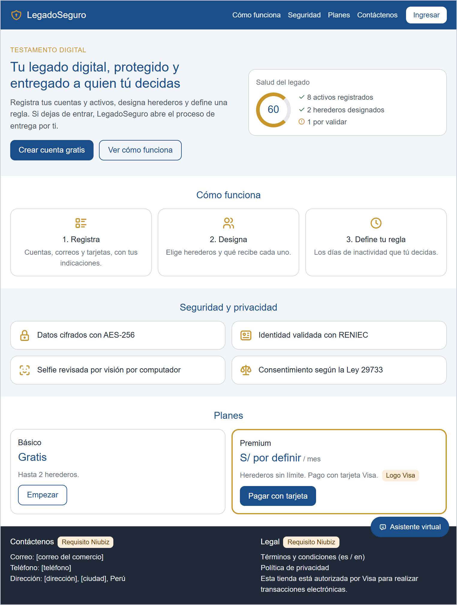

### 3.3 Ficha de implementación

:::paso 3.3.1 Crear el landing page
Objetivo: Presentar el sistema a quien aún no tiene cuenta y cumplir los requisitos de visibilidad que pide Niubiz para certificar el comercio.
Acción: Crear el componente independiente `landing`, registrarlo como ruta pública de inicio y enlazar sus botones con el registro y el inicio de sesión existentes.
Comando: Archivos `pages/landing/landing.ts`, `landing.html` y `landing.css`; ruta de inicio y `visitanteGuard` en `app.routes.ts` y `core/auth.guard.ts`; en el backend, `GET /api/planes` (pública).
Explicación: La página es contenido propio con la marca del sistema (azul `#1A4E8A` y dorado `#C9962C`) y un solo acento coral en los botones de registro. Los planes y su precio se leen de la base con el endpoint público `/api/planes`, para no copiarlos a mano. Quien ya tiene sesión va directo al dashboard. Los datos de contacto están en un solo lugar (`landing.ts`).
Evidencia: 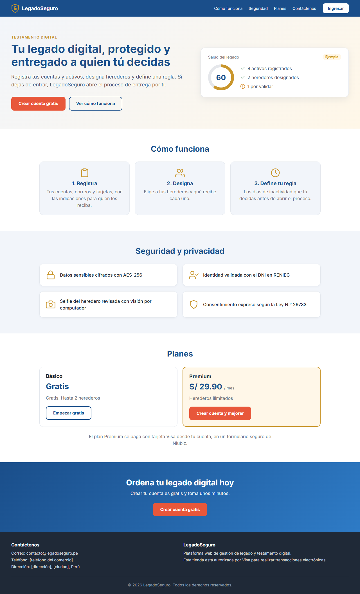
Resultado esperado: Al abrir la dirección raíz se ve el landing; "Ingresar" y "Crear cuenta gratis" llevan a las pantallas ya existentes.
Error frecuente: Que la ruta raíz siga mandando directo al inicio de sesión, o que el menú se corte en pantallas de 768 px.
Solución: Revisar el orden de las rutas en `app.routes.ts` y probar los anchos de 360, 768 y 1280 px con las herramientas de desarrollo del navegador.
Verificación: `npx ng build` termina sin errores y el recorrido landing, registro e inicio de sesión funciona en los tres anchos.
:::

## 4. Mejora 2: asistente virtual de orientación

### 4.1 Qué problema resuelve

Un propietario que va a registrar su legado tiene dudas: qué activos puede dejar, qué pasa si deja de entrar, cómo se protegen sus datos o qué valida el heredero. Hoy debe buscar la respuesta por su cuenta o escribirnos. El asistente responde en el momento, desde el landing y desde su panel.

### 4.2 Diseño propuesto

**Estado: implementada** (24/11/2026).

- **Funcionamiento:** el usuario escribe una pregunta; el backend busca el tema más parecido en la tabla `guia_legal` (campos `tema`, `palabras_clave` y `contenido`, con distinto peso) con la búsqueda de texto completo de PostgreSQL en español (PostgreSQL Global Development Group, 2026) y devuelve la respuesta, junto con dos temas relacionados. La búsqueda ignora las tildes y las palabras comunes, y basta con que coincida una palabra.
- **Privacidad:** la pregunta no se guarda ni se envía a servicios externos, y el asistente no pide ni usa datos personales. Siempre muestra el aviso de que es orientación general y no reemplaza a un abogado.
- **Sin coincidencia:** si no encuentra un tema, lista los temas disponibles en lugar de inventar una respuesta.
- **Contenido:** la tabla `guia_legal` estaba vacía el 23/11/2026; la migración `024` cargó **12 temas**: qué es el sistema, qué activos se pueden registrar, cómo designar herederos, qué ocurre si el propietario deja de entrar, cuántos días elegir, cómo cancelar un proceso, cómo se protegen los datos (Ley N.° 29733), para qué sirve la selfie, cómo valida su identidad el heredero, qué documentos necesita, qué incluye el plan Premium y por qué no reemplaza a un testamento. Son preguntas frecuentes sobre cómo funciona el sistema, y un abogado debe revisarlas.
- **Por qué no un modelo de lenguaje externo:** en esta primera versión el asistente es determinista y explicable, no tiene costo por consulta y no saca datos del sistema. Queda abierta una evolución futura que use la misma tabla como base de conocimiento.

### 4.3 Ficha de implementación

:::paso 4.3.1 Crear el asistente virtual
Objetivo: Responder preguntas frecuentes de orientación usando la guía del propio sistema, sin enviar datos personales a terceros.
Acción: Cargar los temas en `guia_legal`, crear el endpoint público de consulta con límite de pedidos por minuto y el componente flotante del asistente en Angular.
Comando: Migración `024_guia_asistente.sql` con los temas y las palabras clave; `GET /api/asistente/temas` y `POST /api/asistente/preguntar` (públicos, con límite de pedidos); archivos `asistente.service.ts`, `asistente.controller.ts` y `asistente.routes.ts` en el backend y `components/asistente/` en Angular.
Explicación: El endpoint recibe solo el texto de la pregunta (o el número de un tema elegido), quita tildes y palabras comunes, arma una consulta `to_tsquery('spanish', ...)` con las palabras restantes y ordena los temas con `ts_rank_cd`. El componente usa *signals* para el historial de la conversación, avisa a los lectores de pantalla con una región `aria-live` y se muestra en todas las pantallas, también antes de iniciar sesión.
Evidencia: 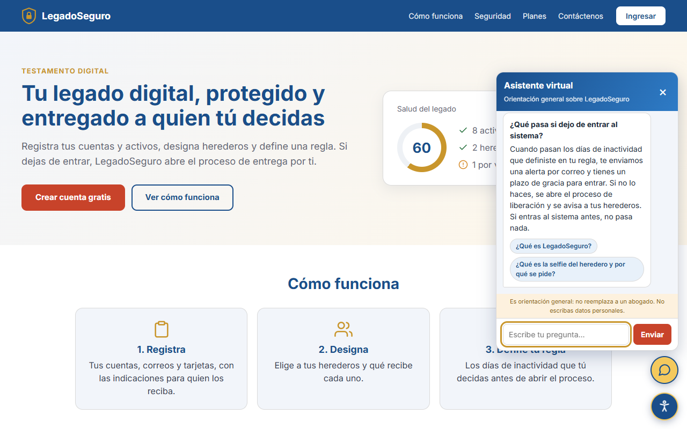
Resultado esperado: Una pregunta como "qué pasa si dejo de entrar" devuelve el tema de la regla de inactividad; una pregunta sin relación devuelve la lista de temas disponibles.
Error frecuente: Respuestas poco relevantes por redacción distinta a la del contenido, o una consulta vacía que devuelve todos los temas.
Solución: Incluir sinónimos en las palabras clave de cada tema, validar que la pregunta tenga entre 3 y 300 caracteres y responder 400 en caso contrario.
Verificación: Pruebas P-72 a P-74 (sección 8), aprobadas: de 12 preguntas, las 10 con tema encontraron el esperado y las 2 sin relación ofrecieron la lista de temas; la pregunta 11 en un minuto responde 429; una pregunta vacía o de 301 caracteres responde 400.
:::

## 5. Mejora 3: sugerencia inteligente de días de inactividad

### 5.1 Qué problema resuelve

El propietario define cuántos días de inactividad deben pasar antes de abrir un proceso de liberación (entre 7 y 3650). Si elige muy pocos días, el sistema lo alertará sin motivo; si elige demasiados, la entrega se demora. Hoy no tiene una referencia propia para decidir.

### 5.2 Diseño propuesto

La sugerencia se calcula con el historial real de ingresos del propietario, guardado en `actividad_usuario` con el tipo de evento `INICIO_SESION`:

1. Se toman sus ingresos de los últimos 12 meses y se calculan los intervalos, en días, entre un ingreso y el siguiente.
2. Se obtiene el **percentil 90** de esos intervalos: el tiempo que normalmente no supera entre un ingreso y otro.
3. Se multiplica por un **margen de seguridad** (inicialmente 3) y se redondea al siguiente valor de los atajos de la pantalla (15, 30, 90, 180 o 365 días), respetando el rango permitido.
4. Si hay **menos de 5 intervalos**, no hay historial suficiente: se sugiere 90 días y se explica que es el valor por defecto.
5. La pantalla muestra el motivo en lenguaje claro: "Normalmente pasas hasta 12 días entre un ingreso y otro. Este plazo deja un margen para no recibir alertas innecesarias", con un botón para aplicarlo. Con los datos actuales de la demo ningún usuario llega aún a 5 intervalos, así que la pantalla muestra el valor por defecto con su aviso.

**Por qué estadística y no aprendizaje automático.** Hoy `actividad_usuario` tiene 53 inicios de sesión de 4 usuarios (consultado el 23/11/2026), casi todos de pruebas. Con ese volumen, entrenar un modelo supervisado no se podría justificar. La estadística descriptiva funciona con pocos datos, se explica en una línea y se calcula en TypeScript sin librerías nuevas. Cuando el sistema acumule historial real, esta función puede reemplazarse por un modelo entrenado sin cambiar la pantalla. El margen de seguridad es un parámetro de diseño que se validará con los usuarios de prueba.

### 5.3 Ficha de implementación

:::paso 5.3.1 Calcular y mostrar la sugerencia
Objetivo: Ayudar al propietario a elegir sus días de inactividad con base en su propio comportamiento y no solo en valores genéricos.
Acción: Crear la función de cálculo en el servicio de reglas, exponerla en un endpoint con sesión y mostrar la sugerencia en la pantalla de la regla.
Comando: `GET /api/reglas/sugerencia`; función pura `calcularSugerencia` en `utils/sugerencia-inactividad.ts` y `sugerirDias` en `regla.service.ts`; ajuste en la pantalla de reglas de Angular.
Explicación: La consulta lee solo los ingresos del propio usuario autenticado. El cálculo del percentil y del redondeo es una función pura, fácil de probar con listas de fechas conocidas. No hay migración: se usa una tabla existente.
Evidencia: 
Resultado esperado: Un usuario que entra cada 10 días recibe una sugerencia de 30 (10 × 3 = 30); uno que entra cada 12 días recibe 90 (12 × 3 = 36, redondeado al siguiente atajo); un usuario con 2 ingresos recibe el valor por defecto con el aviso de historial insuficiente.
Error frecuente: Sugerencias absurdas por ingresos duplicados el mismo día o por un único ingreso muy antiguo.
Solución: Contar un solo ingreso por día y descartar los intervalos de menos de un día.
Verificación: Pruebas P-68 a P-71 (sección 8), con listas de fechas conocidas y resultado calculado a mano.
:::

## 6. Mejora 4: cobro del plan Premium con Niubiz

### 6.1 Qué se decidió y por qué

El plan Premium estaba previsto con Culqi. El grupo cambió a **Niubiz** (antes VisaNet) porque se cuenta con su documentación de integración y de pruebas. El formulario Pago Web de Niubiz se inserta en la página del comercio sin redirigir al cliente y se integra en cuatro pasos: token de seguridad, sesión de pago, botón de pago y autorización (VisaNet Perú, 2025; Niubiz, 2026).

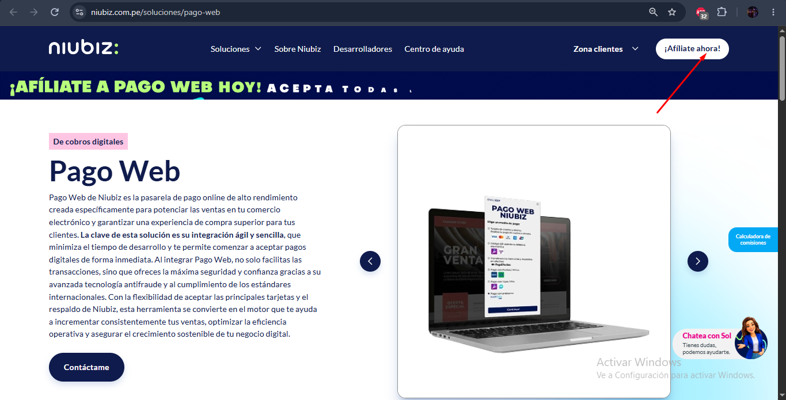

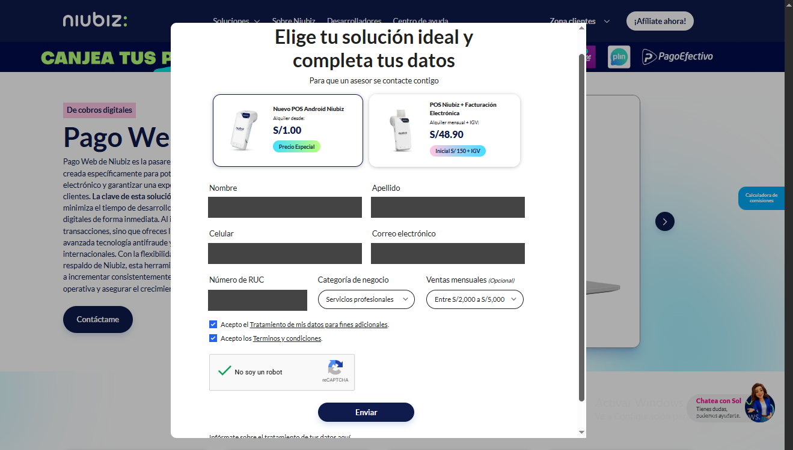

### 6.2 Qué ya está hecho

- Migración `023` aplicada en la base: la tabla `pago` guarda el número de pedido único, el id de transacción, la tarjeta enmascarada y el código de acción.
- Servicio `niubiz.service.ts` con los tres llamados al servicio de Niubiz, que usa el ambiente de pruebas o de producción según una variable de entorno.
- Rutas para iniciar el pago, recibir la respuesta del formulario y consultar el resultado, y el botón **Pagar con tarjeta** en la pantalla de Suscripción.
- Decisiones de seguridad: el monto sale siempre de la tabla `plan` y no del navegador; el plan solo se activa con código de acción `000` y monto coincidente; cada pedido se procesa una sola vez; las credenciales viven solo en el `.env` del backend; si Niubiz cobra pero no se puede activar el plan, el pago queda en estado `REVISAR`.

### 6.3 Qué falta

- **Credenciales de pruebas** (código de comercio, usuario y contraseña), que entrega Niubiz al afiliar el comercio. El código compila, pero **todavía no se probó ningún cobro**.
- **Requisitos para certificar:** logo de Visa, sección Contáctenos, términos y condiciones dentro del flujo de compra, comprobante por correo y certificado SSL. El landing (M1) cubre buena parte.
- **Pruebas con las tarjetas de prueba** del documento de integración: autorizado, denegado y tarjeta foránea.

### 6.4 Ficha de implementación

:::paso 6.4.1 Probar el cobro en el ambiente de pruebas
Objetivo: Comprobar que un pago aprobado activa el plan Premium y que uno denegado no lo cambia.
Acción: Colocar las credenciales de pruebas en `backend/.env`, iniciar sesión como propietario de prueba y pagar con las tarjetas de prueba de Niubiz.
Comando: `NIUBIZ_MERCHANT_ID`, `NIUBIZ_USER`, `NIUBIZ_PASSWORD` y `NIUBIZ_ENV=test` en el `.env`; `npm run dev` en `backend` y `npx ng serve` en `frontend`.
Explicación: El formulario de Niubiz se abre sobre la pantalla de Suscripción, envía el resultado al backend y este pide la autorización. El resultado final se consulta con el número de pedido.
Evidencia: ==Capturas del formulario, del resultado aprobado y de la fila en la tabla pago (se toman con las credenciales de pruebas)==
Resultado esperado: Pago aprobado: el plan queda en Premium y el historial muestra el pago como COMPLETADO. Pago denegado: el plan no cambia y se muestra el motivo.
Error frecuente: Credenciales incorrectas, sesión de pago vencida (30 minutos) o número de pedido repetido.
Solución: Verificar las variables del `.env`, volver a iniciar el pago y recordar que cada intento crea un número de pedido nuevo.
Verificación: Pruebas P-75 a P-78 (sección 8).
:::

## 7. Mejoras adicionales propuestas

Además de las cuatro mejoras anteriores, el grupo propone siete más. Se presentan en el mismo orden de la tabla de la sección 2, de mayor a menor impacto. Cada una lleva su ficha de implementación. Solo la mejora 5 (accesibilidad) está implementada; las demás son propuestas, y su ejecución depende del tiempo disponible.

### 7.1 Mejora 7: llave compartida entre herederos

**Qué problema resuelve.** Hoy los datos sensibles se cifran en el servidor con una sola clave (`ENCRYPTION_KEY`), así que quien administre el servidor podría leerlos. Además, el sistema ya pide "k de N herederos deben confirmar" para liberar un legado, pero esa regla no protege el contenido en sí.

**Qué se propone.** Llevar esa regla a la criptografía: el contenido se cifra en el navegador del propietario con la Web Crypto API (Mozilla Developer Network, 2026b) y la llave se divide en N partes con el esquema de reparto de secretos de Shamir (1979), de modo que se necesitan **k partes** para reconstruirla. Cada heredero recibe una parte; solo cuando k de ellos la aportan se puede descifrar. La plataforma guarda el contenido cifrado y las partes, pero nunca la llave completa, por lo que ni siquiera ella puede leer el contenido.

**Alcance realista.** Un prototipo con un activo de prueba, que no reemplaza el cifrado actual. Para no inventar criptografía, el cifrado usa la Web Crypto API del navegador y el reparto de la llave una librería de Shamir revisada. El riesgo se declara: si se pierden las partes, **no hay recuperación posible**.

:::paso 7.1.1 Prototipo de llave compartida
Objetivo: Demostrar que ni la plataforma puede leer un contenido y que solo se descifra cuando k de N herederos aportan su parte.
Acción: Crear un servicio de Angular que cifre un texto con AES-GCM, divida la llave en N partes con Shamir y la reconstruya con k partes, y mostrarlo en una pantalla de demostración.
Comando: `crypto.subtle.generateKey` y `crypto.subtle.encrypt` de la Web Crypto API; una librería de Shamir revisada (a elegir y verificar); `npx ng generate service services/llave-compartida`.
Explicación: La llave completa nunca viaja al servidor: solo se guardan el texto cifrado y las partes. Con menos de k partes, el esquema de Shamir no revela información sobre la llave.
Evidencia: ==Capturas de la demostración: reparto de la llave, recuperación con 3 de 5 partes y fallo con 2 (se toman al implementar)==
Resultado esperado: Con 3 de 5 partes se recupera el texto original; con 2 partes no se obtiene nada.
Error frecuente: Mezclar partes de secretos distintos, copiar mal una parte, o creer que el contenido se puede recuperar si se pierden las partes.
Solución: Validar el formato de cada parte, mostrar un código de verificación del secreto y avisar con claridad que sin k partes no hay recuperación.
Verificación: Pruebas P-83 y P-84 (sección 8).
:::

### 7.2 Mejora 5: accesibilidad e inclusión

**Qué problema resuelve.** Una persona con baja visión, una persona ciega o alguien que prefiere pantallas oscuras puede quedar fuera del sistema, y un legado digital debería poder gestionarlo cualquier persona. La Ley N.° 29973 (Congreso de la República del Perú, 2012), a validar con un abogado, y las pautas WCAG 2.1 (World Wide Web Consortium, 2018) son el marco de referencia.

**Estado: implementada** (24/11/2026), con las limitaciones que se indican al final.

**Qué se implementó.**
- **Botón flotante de accesibilidad**, disponible en todas las pantallas, con **modo oscuro** (que recuerda la elección y, la primera vez, respeta la preferencia del sistema), **tamaño de letra** del 100 % al 150 % y **alto contraste**.
- **Teclado:** enlace "Saltar al contenido" que aparece con la tecla Tab, indicador de foco visible y cierre del panel con Escape. El panel usa etiquetas, grupos y estados ARIA.
- **Lectura en voz alta** de la pantalla con la Web Speech API (Mozilla Developer Network, 2026c), con botón para detenerla.
- **Tamaños en `rem`:** los tamaños de letra de las hojas de estilo pasaron de píxeles a `rem`, de modo que el texto crece con la opción elegida; el ancho del menú lateral también crece.
- **Contraste:** al medir con Lighthouse se corrigieron dos colores que no alcanzaban la proporción mínima de 4,5 a 1: el gris del texto secundario y el coral de los botones de registro, que se oscureció (de `#E8573A` a `#C8432A`).

**Qué falta.** La alternativa a la selfie para personas ciegas (hoy el paso 3 del portal exige una foto con la cámara; una opción sería una verificación asistida por el validador, a definir con el docente), una prueba con un lector de pantalla real y la revisión de las pantallas con sesión iniciada. Lo implementado no garantiza cumplir WCAG 2.1 (World Wide Web Consortium, 2018) ni la Ley N.° 29973 (Congreso de la República del Perú, 2012), a validar con un abogado.

**Cómo se hizo el modo oscuro.** Los colores neutros de las hojas de estilo (fondos, textos y bordes) se pasaron a variables CSS que cambian según el tema, con una conversión automática y una revisión visual de las pantallas principales. Para ahorrar variables, algunos tonos de fondo y de borde muy parecidos se unificaron en uno solo, de modo que el modo claro cambió muy poco en esos detalles.

:::paso 7.2.1 Panel de accesibilidad
Objetivo: Permitir que más personas usen el sistema con comodidad, ajustando el aspecto y escuchando el contenido.
Acción: Pasar los colores neutros y los tamaños de letra de las hojas de estilo a variables y a `rem`, crear un servicio con *signals* que guarde las preferencias y agregar el botón flotante, el enlace "Saltar al contenido" y la lectura en voz alta.
Comando: Archivos `services/accesibilidad.service.ts` y `components/accesibilidad/` (ts, html y css); variables CSS y los atributos `data-tema`, `data-contraste` y `data-bs-theme` sobre la etiqueta `html`, en `styles.css`; `localStorage` para recordar la elección; `window.speechSynthesis` para la lectura en voz alta; `npx ng build` para comprobar la compilación.
Explicación: Las preferencias se aplican sobre la raíz del documento, así que cambian todas las pantallas a la vez. La lectura en voz alta usa las voces del navegador y lee el texto que está en pantalla, que puede incluir datos del usuario; como algunas voces procesan el texto en línea, se prefieren las voces locales del dispositivo y la lectura solo empieza cuando el usuario la pide.
Evidencia: 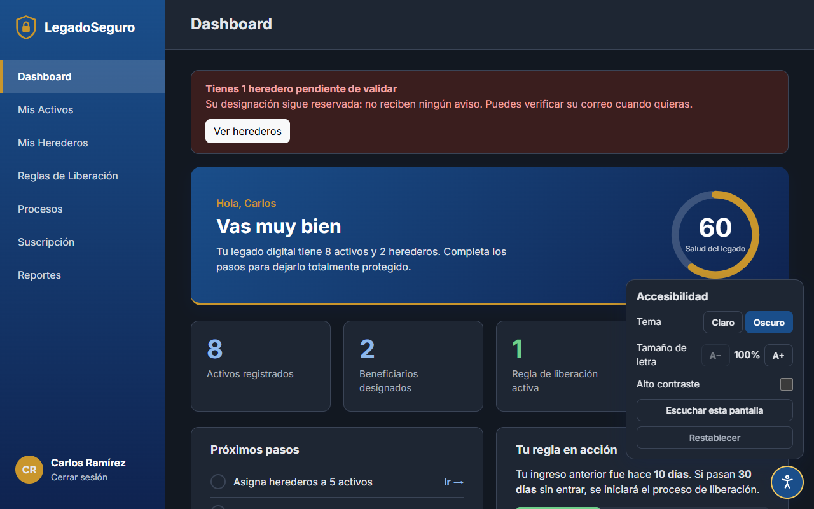
Resultado esperado: El usuario activa el modo oscuro y el texto grande, recarga la página y sus preferencias se mantienen; el botón "Escuchar esta pantalla" lee el texto y se puede detener.
Error frecuente: Colores escritos a mano que no cambian con el modo oscuro, textos con tamaño fijo que no crecen o contrastes por debajo de 4,5 a 1.
Solución: Revisar las hojas de estilo buscando colores y tamaños fijos, usar variables y `rem`, y medir el contraste con Lighthouse.
Verificación: Pruebas P-79 a P-82 (sección 8): modo oscuro y tamaño de letra aprobados; Lighthouse de accesibilidad de 100 en el landing, el inicio de sesión y el registro (antes de corregir los contrastes, el landing tenía 95).
:::

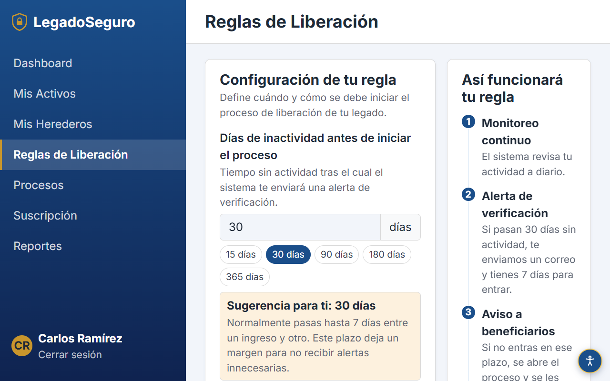

### 7.3 Mejora 8: mensaje póstumo

**Qué problema resuelve.** Un legado no son solo cuentas y contraseñas: los herederos suelen valorar una despedida o unas palabras en la voz del propietario. El sistema hoy solo entrega indicaciones por escrito.

**Qué se propone.** El propietario graba un audio o un video corto, o escribe una carta, con la MediaRecorder API del navegador (Mozilla Developer Network, 2026a). El mensaje se guarda cifrado y se entrega al heredero junto con los activos, cuando el proceso termina. El propietario puede regrabarlo o borrarlo en cualquier momento. Se empieza por audio y texto, porque el video pesa y encarece el almacenamiento, y el tamaño se limita según el plan.

:::paso 7.3.1 Grabar y entregar un mensaje póstumo
Objetivo: Permitir que el propietario deje un mensaje personal que reciba el heredero al liberarse el legado.
Acción: Crear el componente de grabación en Angular, el endpoint para guardar el mensaje cifrado y la pantalla donde el heredero lo escucha tras la liberación.
Comando: `new MediaRecorder(stream)` y `navigator.mediaDevices.getUserMedia`; almacenamiento de archivos cifrados (a decidir); `npx ng generate component components/mensaje-postumo`.
Explicación: El mensaje solo se muestra al heredero cuando el proceso de liberación llega a su fin. El propietario da su consentimiento y puede borrarlo; el límite de duración y de tamaño evita abusos.
Evidencia: ==Capturas de la grabación, de la lista de mensajes y de la reproducción por el heredero (se toman al implementar)==
Resultado esperado: El propietario graba 30 segundos de audio, el mensaje queda guardado cifrado y el heredero lo reproduce solo después de la liberación.
Error frecuente: El navegador no tiene permiso para el micrófono, o el archivo supera el límite de tamaño.
Solución: Explicar cómo conceder el permiso, mostrar el tiempo restante mientras graba y rechazar con un mensaje claro lo que exceda el límite.
Verificación: Prueba P-85 (sección 8).
:::

### 7.4 Mejora 9: app instalable con avisos

**Qué problema resuelve.** Las alertas de inactividad llegan solo por correo, que puede no leerse a tiempo.

**Qué se propone.** Convertir el sistema en una **aplicación web instalable** (PWA) con un manifiesto y un *service worker*, que se instala en el celular como cualquier app, y enviar **notificaciones push** del navegador para la alerta de inactividad y para el aviso "sigo aquí" de la mejora 10 (Angular, 2026). Requiere HTTPS, por lo que depende del despliegue, y el soporte de las notificaciones varía según el sistema operativo.

:::paso 7.4.1 Instalar la aplicación y recibir avisos
Objetivo: Que el propietario reciba las alertas importantes en su celular sin depender del correo.
Acción: Agregar la compatibilidad con PWA a Angular, registrar el service worker y suscribir al usuario a las notificaciones con su permiso.
Comando: `ng add @angular/pwa` y la API `Notification` y `PushManager` del navegador; un endpoint para guardar la suscripción.
Explicación: El service worker permite que el sistema se instale y reciba avisos aunque la página esté cerrada. El usuario puede quitar los avisos cuando quiera.
Evidencia: ==Capturas de la instalación en el celular y de una notificación recibida (se toman al implementar)==
Resultado esperado: La app se instala desde el navegador y una alerta de prueba llega como notificación.
Error frecuente: Probar sin HTTPS o en un navegador sin soporte de notificaciones push.
Solución: Probar con el sistema desplegado y detectar el soporte para mostrar un aviso si no está disponible.
Verificación: Prueba P-86 (sección 8).
:::

### 7.5 Mejora 10: verificación "sigo aquí" con un clic

**Qué problema resuelve.** La inactividad se mide por inicios de sesión. Un propietario que está bien pero no entra al sistema recibe la alerta, y para responder debe iniciar sesión.

**Qué se propone.** Añadir a la alerta previa un enlace de **un solo uso** "Sigo aquí" que reinicia el contador sin iniciar sesión. El enlace caduca, se guarda solo su huella en la base, igual que el código de verificación que el sistema ya usa, y cada uso queda en la auditoría. Reduce los falsos positivos sin bajar la seguridad.

:::paso 7.5.1 Enlace "sigo aquí" en la alerta
Objetivo: Que el propietario confirme que sigue activo con un solo clic desde su correo.
Acción: Generar un token aleatorio en cada alerta, guardar su huella con fecha de vencimiento, exponer un endpoint público con límite de pedidos y registrar el uso en la auditoría.
Comando: `crypto.randomBytes(32)` en Node.js; una migración con la columna de la huella; `GET /api/vivo/:token`.
Explicación: El token es largo y aleatorio, se usa una sola vez y vence. Al usarlo se registra una actividad del propietario, de modo que el monitoreo lo trata como si hubiera entrado.
Evidencia: ==Capturas del correo con el botón y de la confirmación (se toman al implementar)==
Resultado esperado: El primer clic reinicia la inactividad; un segundo clic o un enlace vencido se rechazan.
Error frecuente: Que el enlace pueda reutilizarse, o que lo abra automáticamente un antivirus de correo y confirme sin que el usuario lo sepa.
Solución: Marcar el token como usado en la misma consulta y pedir un clic en un botón de confirmación en vez de actuar al abrir el enlace.
Verificación: Prueba P-87 (sección 8).
:::

### 7.6 Mejora 6: idiomas

**Qué problema resuelve.** Propietarios o herederos que viven en el extranjero, o que no hablan español, no pueden usar el sistema.

**Qué se propone.** Un selector de idioma que recuerda la elección. Se empieza por el **inglés** en el landing, el inicio de sesión y el portal del heredero, con archivos de traducción (`es.json` y `en.json`) y un servicio con *signals*, sin librerías nuevas. El **portugués** queda como trabajo futuro. El **quechua** aportaría un valor distinto, por ser una lengua muy hablada en Perú, pero la traducción debe revisarla un hablante. Los textos legales traducidos son informativos y no reemplazan a la versión en español.

:::paso 7.6.1 Selector de idioma
Objetivo: Permitir usar el landing, el inicio de sesión y el portal del heredero en inglés.
Acción: Crear los archivos de traducción, un servicio que cargue el idioma elegido y reemplazar los textos fijos de esas pantallas por claves.
Comando: Archivos `assets/i18n/es.json` y `en.json`; `npx ng generate service services/idioma`.
Explicación: Cada texto de la pantalla se busca por su clave en el idioma activo, que se guarda en `localStorage`. Los mensajes del servidor siguen en español en esta primera versión.
Evidencia: ==Capturas del landing en español y en inglés (se toman al implementar)==
Resultado esperado: Al elegir inglés cambian los textos de las tres pantallas y la elección se mantiene al recargar.
Error frecuente: Claves que faltan en un idioma y se ven como código en la pantalla.
Solución: Usar el español como idioma de respaldo cuando una clave no exista.
Verificación: Prueba P-88 (sección 8).
:::

### 7.7 Mejora 11: tarjeta de emergencia con código QR

**Qué problema resuelve.** Si el heredero no sabe que el sistema existe, el legado nunca se reclama.

**Qué se propone.** Una hoja imprimible, generada en el navegador, con las instrucciones para el heredero y un **código QR** que lleva al portal. No incluye datos sensibles: solo la dirección del portal y los pasos a seguir. El propietario la imprime y la guarda con sus documentos importantes.

:::paso 7.7.1 Generar la tarjeta de emergencia
Objetivo: Que el heredero sepa dónde y cómo reclamar el legado.
Acción: Generar un código QR con una librería de JavaScript y armar una hoja imprimible con instrucciones, desde la pantalla de herederos.
Comando: Una librería de QR para JavaScript y `window.print()` con una hoja de estilos de impresión.
Explicación: El QR se calcula en el navegador, sin enviar datos a terceros, y solo contiene la dirección pública del portal.
Evidencia: ==Captura de la hoja generada (se toma al implementar)==
Resultado esperado: Al escanear el QR con el celular se abre el portal del heredero.
Error frecuente: Que el QR quede muy pequeño para leerse al imprimir.
Solución: Fijar un tamaño mínimo y probar la lectura con un celular antes de dar por terminada la hoja.
Verificación: Prueba P-89 (sección 8).
:::

## 8. Pruebas previstas

Las pruebas nuevas continúan la numeración del manual (P-01 a P-67) y se ejecutarán de verdad antes de documentarlas.

Tabla: Pruebas previstas para las mejoras
| Código | Mejora | Prueba | Resultado esperado | Estado |
|---|---|---|---|---|
| P-68 | M3 | Usuario que entra cada 10 días | Sugiere 30 días y explica el motivo | Aprobada |
| P-69 | M3 | Usuario con menos de 5 intervalos | Sugiere 90 y avisa que falta historial | Aprobada |
| P-70 | M3 | Ingresos duplicados el mismo día | Cuenta un solo ingreso por día | Aprobada |
| P-71 | M3 | Sugerencia fuera del rango 7 a 3650 | Se ajusta al límite permitido | Aprobada |
| P-72 | M2 | Pregunta con tema en la guía | Devuelve el tema más relevante | Aprobada |
| P-73 | M2 | Pregunta sin relación | Lista los temas disponibles | Aprobada |
| P-74 | M2 | Más de 10 preguntas por minuto desde una IP | Responde 429 | Aprobada |
| P-75 | M4 | Pago con tarjeta de prueba autorizada | Plan Premium activo, pago COMPLETADO | Pendiente |
| P-76 | M4 | Pago con tarjeta de prueba denegada | Plan sin cambios, pago DENEGADO | Pendiente |
| P-77 | M4 | Reenvío del mismo pedido | No se cobra dos veces | Pendiente |
| P-78 | M4 | Monto alterado desde el navegador | Se ignora; se cobra el precio del plan | Pendiente |
| P-79 | M5 | Activar el modo oscuro y recargar la página | La preferencia se mantiene | Aprobada |
| P-80 | M5 | Aumentar el tamaño de letra | Todo el texto crece sin desbordar el diseño | Aprobada |
| P-81 | M5 | Completar el registro de un activo solo con el teclado | Se puede terminar sin usar el ratón | Parcial |
| P-82 | M5 | Informe de accesibilidad de Lighthouse en las pantallas principales | Puntuación objetivo de 90 o más (objetivo a medir) | Aprobada en pantallas públicas |
| P-83 | M7 | Repartir la llave en 5 partes y usar 3 | Se recupera el texto original | Pendiente |
| P-84 | M7 | Usar solo 2 de las 5 partes, o una parte alterada | No se obtiene nada y el mensaje de error no revela información | Pendiente |
| P-85 | M8 | Grabar un audio y entregarlo tras la liberación | Solo el heredero lo reproduce, y solo al terminar el proceso | Pendiente |
| P-86 | M9 | Instalar la app y enviar una alerta de prueba | Llega la notificación | Pendiente |
| P-87 | M10 | Usar el enlace "sigo aquí" dos veces, y uno vencido | El primero reinicia la inactividad; los otros dos se rechazan | Pendiente |
| P-88 | M6 | Cambiar el idioma a inglés y recargar | Cambian los textos y la elección se mantiene | Pendiente |
| P-89 | M11 | Escanear el código QR de la tarjeta | Abre el portal del heredero | Pendiente |

## 9. Cómo se documentará

- **Manual de construcción:** cada mejora entra como procedimiento con su tabla de 10 filas, con comandos y capturas reales. Los cambios se reflejan de forma retroactiva en los procedimientos que ya existen (planes, reglas, rutas y diccionario de datos).
- **Documentación del sistema:** se actualizan requisitos, pruebas y el diccionario de datos, que se genera desde la base.
- **Bitácora:** `AVANCES.md` registra cada mejora con su fecha.
- **Evidencias:** las salidas de terminal y de base de datos son reales; las capturas de pantalla se toman con el sistema funcionando, y las que aún no existen quedan marcadas como pendientes.

## 10. Cronograma previsto

Tabla: Cronograma de las mejoras
| Fecha | Hito |
|---|---|
| Lunes 23 y martes 24/11 | M3 (sugerencia inteligente), M1 (landing page) y M5 (accesibilidad) implementadas y probadas; presentar esta propuesta y confirmar el alcance con el docente |
| Miércoles 25/11 | M2: contenido de la guía, endpoint y componente del asistente virtual |
| Jueves 26/11 | M5: revisar la accesibilidad de las pantallas con sesión, probar con un lector de pantalla y definir la alternativa a la selfie; tomar las capturas del manual |
| Viernes 27/11 | Presentación en borrador con lo implementado y documentado |
| Hasta el martes 01/12 | Si alcanza el tiempo: prototipo de M7 (llave compartida); las demás mejoras quedan como propuesta |
| Martes 01/12 | Inicio de las exposiciones |
| Al recibir las credenciales | M4: pruebas del cobro con Niubiz y su documentación |

## 11. Riesgos y mitigación

Tabla: Riesgos de las mejoras
| Riesgo | Efecto | Mitigación |
|---|---|---|
| Niubiz demora en entregar las credenciales | M4 no se puede probar a tiempo | Presentar M4 como implementado y pendiente de pruebas, con el flujo documentado |
| Poco historial de ingresos en `actividad_usuario` | La sugerencia (M3) sería poco precisa | Valor por defecto con aviso y margen ajustable; se declara que no es aprendizaje automático |
| Contenido legal incorrecto en el asistente | Orientación equivocada al usuario | Textos con fuente citada, revisados por el grupo, con aviso de orientación general |
| Demasiadas mejoras para el plazo | Alguna queda incompleta | Priorización por impacto: se ejecutan primero las de mayor valor y menor esfuerzo, y el resto queda documentado como propuesta |
| Criptografía mal implementada en la llave compartida (M7) | Falsa sensación de seguridad | Usar solo la Web Crypto API y una librería de Shamir revisada; limitarlo a un prototipo y declarar que no reemplaza el cifrado actual |
| Accesibilidad incompleta (M5) | Algunas pantallas siguen sin ser accesibles | Empezar por las pantallas principales, medir con Lighthouse y declarar que no es una garantía de cumplir WCAG |
| Privacidad y tamaño de los mensajes póstumos (M8) | Almacenamiento costoso o contenido expuesto | Consentimiento, cifrado, límite de tamaño por plan y empezar por audio y texto |
| Traducciones con errores (M6) | Mensajes confusos o sin valor legal | Inglés parcial al inicio, textos legales solo informativos y revisión de un hablante para el quechua |
| Requisitos de certificación de Niubiz | No poder pasar a producción | El landing y los términos y condiciones los cubren; el despliegue con HTTPS sigue pendiente |

## 12. Visión comercial y trabajo futuro

Si LegadoSeguro se ofreciera como un producto real, lo más difícil no sería el código sino la **confianza**: el sistema guarda datos delicados de una persona y los entrega cuando ella ya no está, y solo se puede vender si el cliente cree que es seguro, legal y que va a seguir existiendo. Esta sección resume lo que haría falta; no forma parte de lo que se implementará antes de la presentación, pero muestra hacia dónde puede crecer el proyecto. Los puntos legales deben validarse con un abogado.

### 12.1 Identidad de marca y correos institucionales

El primer paso es un **dominio propio** (por ejemplo `legadoseguro.pe`) y un servicio de correo de empresa. Con él se crean correos por función, de modo que la marca no dependa del correo personal de ninguna integrante. Los correos y las redes sociales se abrirían con estas cuentas, no con cuentas personales.

Tabla: Correos institucionales propuestos
| Correo | Función | Prioridad |
|---|---|---|
| `soporte@` | Ayuda a usuarios y herederos | Alta |
| `contacto@` o `ventas@` | Consultas comerciales; es el dato del "Contáctenos" que pide Niubiz | Alta |
| `privacidad@` | Atención de derechos sobre datos personales (Ley N.° 29733) | Alta |
| `legal@` | Contratos, términos y alianzas | Media |
| `ti@` | Alertas de infraestructura y administración de accesos | Media |
| `facturacion@` | Pagos, comprobantes y reclamos de cobro | Media |
| `marketing@` | Redes sociales y campañas | Media |
| `gerencia@` | Dirección y relaciones institucionales | Media |
| `rrhh@` | Selección de personal, cuando exista un equipo | Baja |
| `no-reply@` | Correos automáticos del sistema, que hoy salen desde una cuenta personal | Alta |

Las redes sociales a abrir son LinkedIn, Instagram, Facebook y TikTok, con el mismo nombre de usuario y el logo del sistema, y con el correo de marketing como cuenta responsable. Las figuras siguientes son **bocetos de diseño** de cada perfil con la identidad del sistema (azul y dorado, y el escudo como avatar); no son cuentas reales, las cifras de seguidores aparecen como "—" y los nombres de usuario son una propuesta que debe comprobarse en cada red.

#### Paleta y criterios de diseño

Para que las redes tengan más vida sin perder la identidad, los perfiles parten del azul y el dorado del sistema y añaden apoyos de color, cada uno con una función. Los criterios se basan en la psicología del color y en cómo se dirige la atención visual; son pautas de diseño, no garantías: su efecto cambia según la persona y la cultura, por lo que se comprobará con las métricas de cada publicación.

Tabla: Paleta de las redes sociales y su función
| Color | Uso en las redes | Efecto buscado |
|---|---|---|
| Azul `#1A4E8A` y azul claro `#2E7BC6` | Avatar, portadas y fondos, con degradado suave | Confianza y seriedad; el azul claro aporta profundidad |
| Dorado `#C9962C` y dorado luminoso `#F4C95D` | Aros del avatar, íconos y destacados | Calidez y valor; es el hilo que une la marca con el sistema |
| Turquesa `#1B8E80` | Publicaciones sobre seguridad y datos | Calma y sensación de protección |
| Coral `#C8432A` | Solo botones de acción, como "Crea tu cuenta gratis" | Un único acento cálido que destaca por contraste y guía la mirada hacia la acción; se oscureció desde `#E8573A` para que el texto blanco tenga un contraste de 4,9 a 1 |
| Crema `#FFF7E8` | Fondos de publicaciones y secciones | Cercanía, en lugar del blanco frío |

Otros criterios aplicados: se evitan el rojo de alarma y el negro, que no corresponden a un tema delicado que debe transmitir tranquilidad; los íconos de hogar, manos y grupos de personas aportan un tono humano; cada pieza tiene un solo punto focal; y el texto mantiene un alto contraste con el fondo.

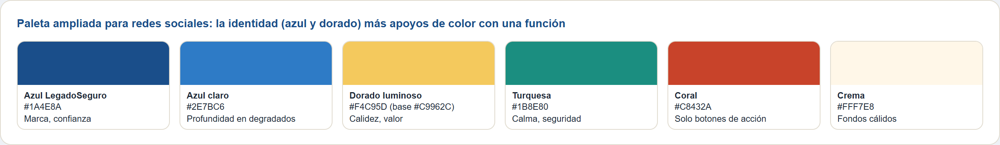

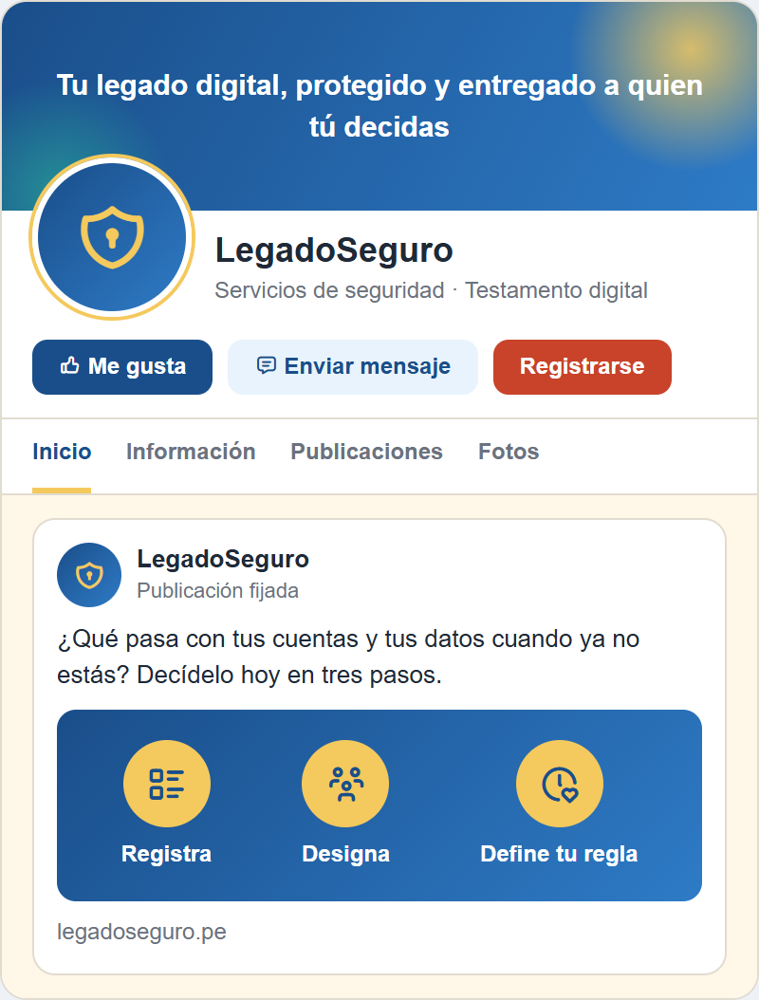

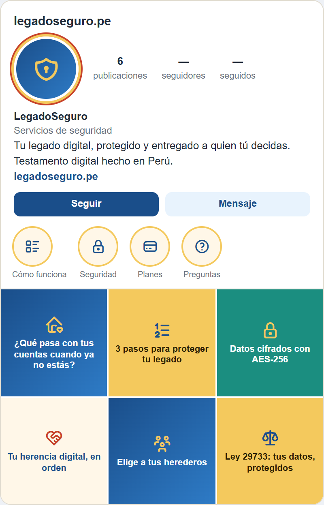

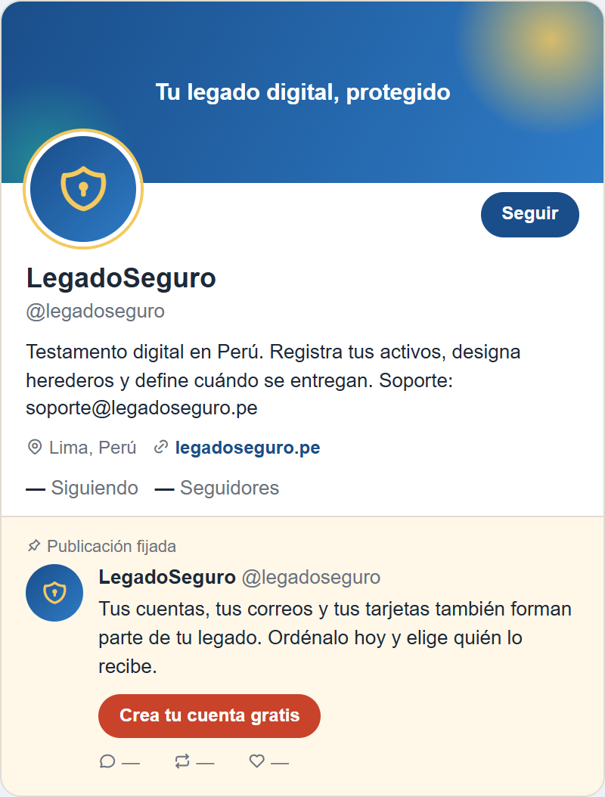

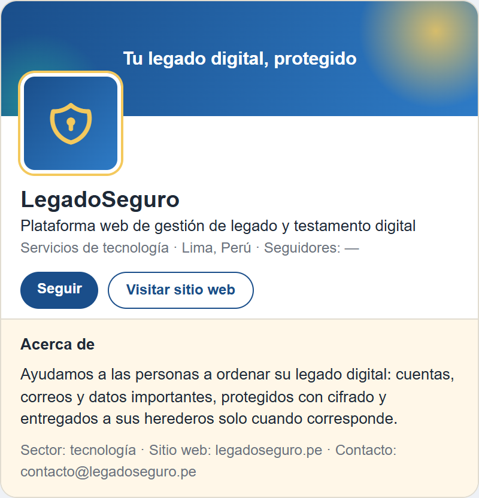

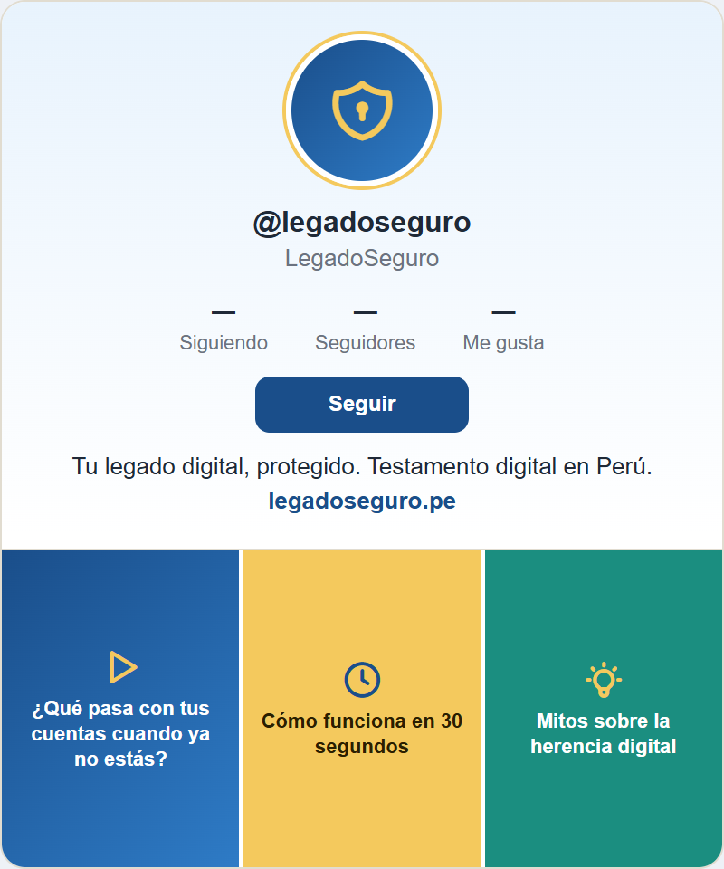

### 12.2 Requisitos legales y de cumplimiento

- **Empresa constituida** (por ejemplo una sociedad anónima cerrada) con RUC, necesaria para afiliarse a Niubiz y para emitir comprobantes.
- **Protección de datos personales:** inscribir el banco de datos ante la autoridad competente, publicar la política de privacidad y atender los derechos de los titulares, conforme a la Ley N.° 29733 (Congreso de la República del Perú, 2011).
- **Libro de reclamaciones** virtual, que el Código de Protección y Defensa del Consumidor exige a quien vende en línea (Congreso de la República del Perú, 2010).
- **Términos y condiciones** en español e inglés, también requisito de certificación de Niubiz (VisaNet Perú, 2025).
- **Registro de la marca** en INDECOPI.
- **Validez de lo que se entrega:** dejar claro que el sistema no reemplaza a un testamento notarial. Una alianza con notarías y estudios de abogados daría respaldo y credibilidad.

### 12.3 Seguridad para producción

Tabla: De la versión del curso a una versión comercial
| Hoy | Para producción |
|---|---|
| Una sola clave de cifrado (`ENCRYPTION_KEY`) guardada en el servidor | Gestor de claves y cifrado por usuario |
| Claves compartidas en el chat durante el desarrollo | Rotarlas y guardar los secretos en un gestor, no en archivos |
| Pruebas manuales (P-01 a P-67) | Pruebas automáticas que se ejecuten en cada cambio |
| Ingreso solo con contraseña (el código por correo se usa al registrarse y al recuperar la contraseña) | Verificación en dos pasos en cada ingreso |
| Base de datos de desarrollo | Respaldos automáticos, monitoreo y plan de recuperación |
| Revisión del propio equipo | Prueba de intrusión por un tercero |

### 12.4 El riesgo propio del producto: cuándo liberar

Decidir **cuándo** entregar es el punto más delicado: liberar a una persona que sigue viva o no liberar nunca son errores graves. Hoy el sistema reduce el riesgo con una alerta previa, un plazo de gracia, confirmaciones de varios herederos y un período de espera final, durante el cual el propietario puede cancelar el proceso. En una versión comercial se añadiría la **verificación del fallecimiento con un documento oficial** y un procedimiento claro para cuando los herederos discrepan.

### 12.5 Modelo de negocio y métricas

- **Ingresos:** suscripción para personas, con los planes Básico y Premium que ya existen, y, con mayor potencial, **alianzas con empresas** (notarías, aseguradoras, bancos y administradoras de fondos) que lo ofrezcan a sus clientes.
- **Métricas desde el primer día:** usuarios registrados, conversión al plan Premium, propietarios que completan su regla y herederos, y cancelaciones.
- **Confianza visible:** testimonios, presencia en medios o universidades y un seguro de responsabilidad por riesgos informáticos.
- **Soporte:** horario definido y tiempos de respuesta, porque el usuario deja información delicada.

### 12.6 Equipo mínimo

Producto y desarrollo, un responsable de seguridad y privacidad (puede ser externo al inicio), soporte al cliente, ventas y marketing, y un abogado de cabecera.

### 12.7 Hoja de ruta sugerida

Tabla: Hoja de ruta comercial (estimación a validar)
| Etapa | Acciones |
|---|---|
| Primeras semanas | Dominio y correos institucionales; landing page (M1); despliegue con HTTPS; rotación de claves |
| De 1 a 3 meses | Certificación en Niubiz (M4); política de privacidad y términos y condiciones; constitución de la empresa; libro de reclamaciones |
| De 3 a 12 meses | Inscripción del banco de datos y de la marca; pruebas automáticas y prueba de intrusión; alianzas con notarías; verificación del fallecimiento |
| Más adelante | Certificación de seguridad de la información; aplicación móvil; subida de archivos; portal del validador externo; comparación facial de la selfie |

## 13. Conclusiones

1. LegadoSeguro ya cubre el ciclo completo del legado digital; las mejoras propuestas atacan lo que falta para que el sistema se entienda, se pueda usar con confianza y se pueda cobrar.
2. Las tres primeras mejoras nuevas (landing, asistente y sugerencia inteligente) se construyen sobre datos y tablas que ya existen, sin depender de servicios externos, y cada una puede probarse y documentarse por separado.
3. El cobro con Niubiz ya está planteado en el código y su documentación de integración fue analizada; solo faltan las credenciales de pruebas para validarlo.
4. Se prefirió una sugerencia estadística explicable frente a un modelo de aprendizaje automático, porque hoy no hay datos suficientes que lo justifiquen; esto se declara de forma abierta en el documento.
5. Las siete mejoras adicionales (sección 7) se ordenaron por impacto. Las de mayor valor son la llave compartida entre herederos, que lleva la regla "k de N" a la criptografía, y la accesibilidad, que abre el sistema a más personas; se ejecutarán según el tiempo disponible y el resto queda documentado como propuesta.
6. Más allá del curso, la sección 12 resume lo que haría falta para ofrecer LegadoSeguro como producto real: identidad de marca y correos institucionales, requisitos legales, seguridad de producción, alianzas y una hoja de ruta por etapas.

## Referencias

ref: Angular. (2026). *Angular documentation*. https://angular.dev
ref: Congreso de la República del Perú. (2010). *Ley N.° 29571, Código de Protección y Defensa del Consumidor*.
ref: Congreso de la República del Perú. (2011). *Ley N.° 29733, Ley de Protección de Datos Personales*.
ref: Congreso de la República del Perú. (2012). *Ley N.° 29973, Ley General de la Persona con Discapacidad*.
ref: Express. (2026). *Express: Fast, unopinionated, minimalist web framework for Node.js*. https://expressjs.com
ref: Google. (2026). *MediaPipe Face Detector guide*. https://ai.google.dev/edge/mediapipe/solutions/vision/face_detector
ref: Mozilla Developer Network. (2026a). *MediaRecorder API*. https://developer.mozilla.org/en-US/docs/Web/API/MediaRecorder_API
ref: Mozilla Developer Network. (2026b). *Web Crypto API*. https://developer.mozilla.org/en-US/docs/Web/API/Web_Crypto_API
ref: Mozilla Developer Network. (2026c). *Web Speech API*. https://developer.mozilla.org/en-US/docs/Web/API/Web_Speech_API
ref: Niubiz. (2026). *Pago Web*. https://www.niubiz.com.pe/soluciones/pago-web
ref: PostgreSQL Global Development Group. (2026). *PostgreSQL documentation: Full text search*. https://www.postgresql.org/docs/current/textsearch.html
ref: Shamir, A. (1979). How to share a secret. *Communications of the ACM, 22*(11), 612-613. https://doi.org/10.1145/359168.359176
ref: VisaNet Perú. (2025). *Documento de integración: Formulario "Pago Web" (versión 6.0)* [Documento PDF]. Niubiz.
ref: World Wide Web Consortium. (2018). *Web Content Accessibility Guidelines (WCAG) 2.1*. https://www.w3.org/TR/WCAG21/
